<p align="center">
  
</p>

<p align="center">
  <picture>
    <source media="(prefers-color-scheme: dark)" srcset="https://readme-typing-svg.demolab.com?font=DM+Sans&weight=500&size=20&duration=3200&pause=1200&color=2EE6D6&center=true&vCenter=true&width=720&height=42&lines=Agents+draft.+I+architect%2C+review%2C+and+ship.;Tech+Lead+%40+Eventbook+via+WireApps;Senior+full-stack+·+Colombo%2C+Sri+Lanka" />
    
  </picture>
</p>

<p align="center">
  <a href="https://www.wijegoonawardana.com/"></a>
  <a href="mailto:anushkaduwolka123@gmail.com"></a>
  <a href="https://www.linkedin.com/in/anushkawijegoonawardana97/"></a>
  
</p>

I lead engineering on production SaaS — architecture, payments, and delivery — with a desk that runs on coding agents. Human review stays on the critical path. No prompt theatre.

---

## Now

| Role | Where | Since |
| --- | --- | --- |
| **Tech Lead** | [Eventbook](https://www.eventbook.ai) via [WireApps](https://www.wireapps.com) — event platform, vendor onboarding, Stripe Connect | Aug 2025 |
| **Senior Full-Stack Engineer** | [WireApps](https://www.wireapps.com) — marketplaces, payments, split payments, event products | Jan 2024 |
| **Founder-engineer** | Own products and studios: OceanOps, Lynx n Co, ThesisTechHub, Ansely Digital | ongoing |

At Eventbook I own architecture across React, React Query, TypeScript, Node.js, and AWS, lead a team of 3, and run the sprints. At WireApps I take the same full-stack brief across client products: marketplaces, Stripe / Stripe Connect payouts, and event platforms.

---

## AI-first engineering

I do not treat agents as autocomplete. I run a terminal workflow with a job for each step, and I sign off before anything moves.

```text
orchestrator  →  planner  →  plan challenger
                    ↓                ↑
               executor  →  reviewer  →  PR handler
                    ↑
              human approval at every gate
```

- **Models in the loop:** Claude Code, Cursor, Codex, Grok, CodeRabbit — I pick the tool, the agents draft, I keep architecture and taste.
- **MCP and automation:** Figma MCP for design-to-code, n8n for ops, per-project PR review rules that draft comments for me to post.
- **Rule:** no silent merges. Plan and code get a human pass. That is how vendor flows, split payments, and admin platforms ship in weeks, not quarters.

---

## Building

Own products and freelance work. Linked only where a public site exists. Client internals stay off this page.

<table>
  <tr>
    <td width="50%" valign="top">
      <h3>OceanOps</h3>
      <p>SaaS app and admin platform for aquarium businesses — multi-tenant stock, sales, finance, and ops. Built solo with an agentic workflow. No public product URL yet.</p>
    </td>
    <td width="50%" valign="top">
      <h3>UniEarn</h3>
      <p>Own product. No public URL yet.</p>
    </td>
  </tr>
  <tr>
    <td width="50%" valign="top">
      <h3><a href="https://www.lynxnco.com">Lynx n Co</a></h3>
      <p>Denim brand I run. Storefront, payments, and an ops layer for stock, partners, and orders — plus n8n automation where the work repeats.</p>
    </td>
    <td width="50%" valign="top">
      <h3><a href="https://www.thesistechhub.com">ThesisTechHub</a></h3>
      <p>EdTech venture I run. Public site plus an internal operations platform (clients, orders, finance), shipped with Figma MCP, Claude Code, and n8n.</p>
    </td>
  </tr>
  <tr>
    <td width="50%" valign="top">
      <h3><a href="https://www.ansely.co.uk">Ansely Digital</a></h3>
      <p>Freelance studio. Recent public work includes the <a href="https://harrisons-spice.co.uk">Harrison Spice</a> restaurant site. Also building a project management tool — no public URL yet.</p>
    </td>
    <td width="50%" valign="top">
      <h3>Agent desk</h3>
      <p>Personal multi-agent assistants, AI PR-review workflows, and MCP-connected tools. The same system I use on Eventbook and the products above. Private by design.</p>
    </td>
  </tr>
</table>

WireApps client work (Glitta, Eventbook, and others) lives in marketplaces, split payments, and event platforms. High-level only.

Public repos — including older learning pins — sit at [github.com/AnushkaWijegoonawardana97](https://github.com/AnushkaWijegoonawardana97?tab=repositories). Current product work is not all public.

---

## Stack

Core tools I actually ship with, from the current CV.

<p>
  
  
  
  
  
  
  
</p>
<p>
  
  
  
  
  
  
  
</p>
<p>
  
  
  
  
  
  
</p>

Also in daily use: Claude Code, Cursor, Codex, Grok, CodeRabbit, Figma MCP, n8n, Clerk, Cognito, PayHere, BullMQ, Meilisearch.

---

## Signal

The old Vercel stats card and WakaTime charts on this profile no longer resolve. Streak + language mix, with light and dark variants.

<p align="center">
  <picture>
    <source media="(prefers-color-scheme: dark)" srcset="https://streak-stats.demolab.com/?user=AnushkaWijegoonawardana97&theme=radical&hide_border=true" />
    
  </picture>
</p>

<p align="center">
  <picture>
    <source media="(prefers-color-scheme: dark)" srcset="https://github-profile-summary-cards.vercel.app/api/cards/repos-per-language?username=AnushkaWijegoonawardana97&theme=radical" />
    
  </picture>
</p>

Pinned repos on this account are older public experiments. They are not the current product work above.

---

## Connect

<p>
  <a href="https://www.wijegoonawardana.com/"></a>
  <a href="mailto:anushkaduwolka123@gmail.com"></a>
  <a href="https://www.linkedin.com/in/anushkawijegoonawardana97/"></a>
  <a href="https://twitter.com/anushka_wije"></a>
  <a href="https://www.instagram.com/anushkawijegoonawardana97/"></a>
  <a href="https://www.facebook.com/AnushkaWijegoonawardana97"></a>
</p>

Colombo, Sri Lanka. Code samples and references on request via [wijegoonawardana.com](https://www.wijegoonawardana.com/).
